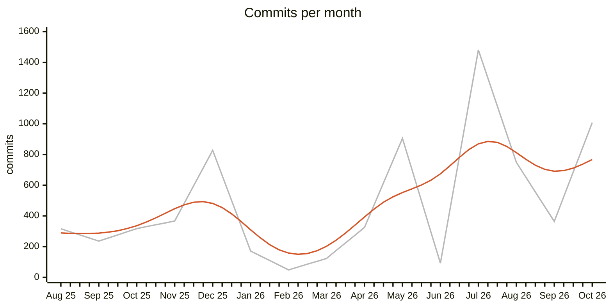
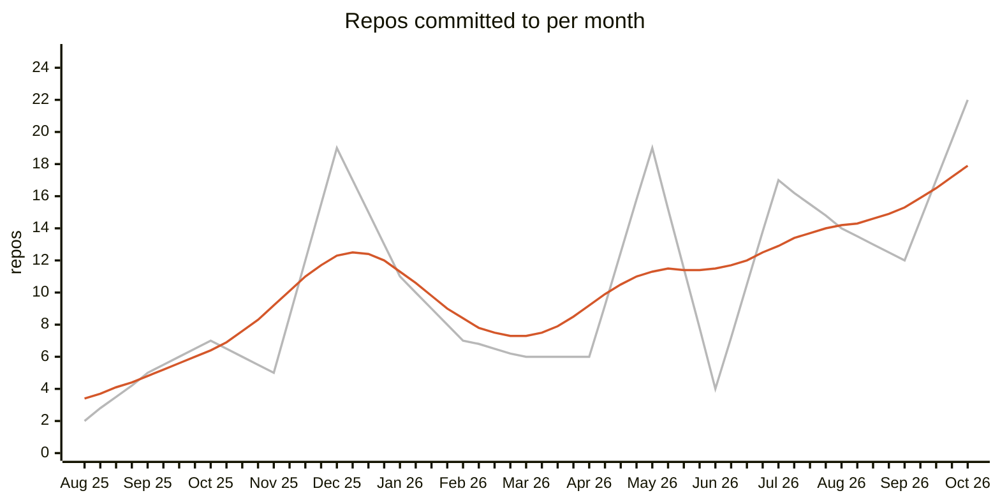
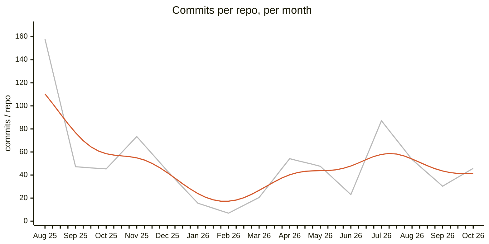
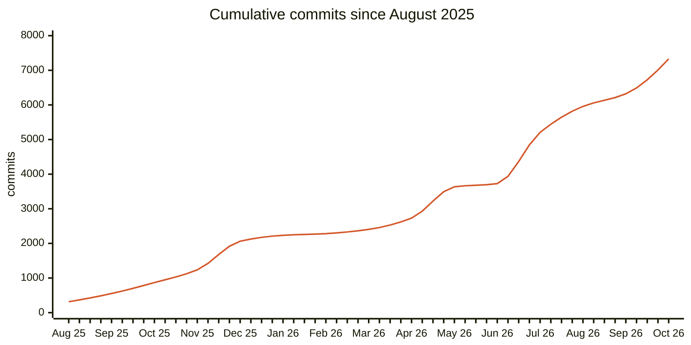

Counts below are taken from the contribution-activity feed in `~/Documents/josephwecker-github-monthly-commits.pdf`, starting at August 2025 and ending at October 2026. "Commits" and "Repos" come from each month's "Created N commits in M repositories" line. "Commits / repo" is commits divided by repos for that month. "New repos" is the feed's "Created N repositories" line; a month that lists commits and has no such line is 0. The feed also covers May–July 2025, which are left out here: May and June had no activity, and July had 3 commits in 2 repos. The PDF ends on "Show more activity," so nothing before May 2025 is in it. October 2026 is as captured: the latest dated item on that page is 25 Oct.

| Month | Commits | Repos | Commits / repo | New repos |
|---|---:|---:|---:|---:|
| August 2025 | 316 | 2 | 158.0 | 1 |
| September 2025 | 236 | 5 | 47.2 | 1 |
| October 2025 | 317 | 7 | 45.3 | 0 |
| November 2025 | 367 | 5 | 73.4 | 0 |
| December 2025 | 827 | 19 | 43.5 | 3 |
| January 2026 | 171 | 11 | 15.5 | 0 |
| February 2026 | 48 | 7 | 6.9 | 0 |
| March 2026 | 123 | 6 | 20.5 | 0 |
| April 2026 | 325 | 6 | 54.2 | 1 |
| May 2026 | 905 | 19 | 47.6 | 1 |
| June 2026 | 92 | 4 | 23.0 | 0 |
| July 2026 | 1,481 | 17 | 87.1 | 0 |
| August 2026 | 749 | 14 | 53.5 | 3 |
| September 2026 | 364 | 12 | 30.3 | 1 |
| October 2026 | 1,007 | 22 | 45.8 | 1 |
| **Total (these months)** | **7,328** | — | — | **12** |
| **Average per month (15)** | **488.5** | **10.4** | **47.0** | **0.8** |

Repos have no total because the same repository is counted again in every month it was committed to, and the feed doesn't say how much those months overlap. The averages are over these 15 months. The commits-per-repo average is pooled — all commits divided by all repo-months (7,328 ÷ 156) — rather than an average of the monthly ratios.

# First Header
*(This is just a quick example to show some basic typography)*
## Charts

In the first three charts the grey line is the actual monthly value, drawn as straight segments between months. The orange curve is a smoothed version: each point is a Gaussian-weighted average of the monthly values (σ = 1 month), sampled every quarter-month. Near the two ends there are fewer neighbouring months to average over, so the curve there leans on fewer months. October 2026 is a partial month (the capture runs to about 25 Oct), so its values, and the curve's last stretch, are likely low. The cumulative chart has no smoothing. It is the running total, with a monotone cubic (PCHIP) curve through the month-end points.

### The first Chart:

## Per-repo commits, where the feed lists them

The feed spells out the per-repository counts for six of these months; for the rest it shows only the month's total. Each list below sums to its month's total.

- **August 2025** — v2-io/temporal-software-theory 258 · josephwecker/v2-cortex 58
- **September 2025** — v2-io/sapientia 94 · v2-io/synaptic 70 · v2-io/temporal-software-theory 56 · josephwecker/book-reader 9 · v2-io/zoetica 7
- **November 2025** — v2-io/sar 200 · v2-io/autopax 71 · v2-io/nexum 53 · v2-io/ennaos 35 · v2-io/sapientia 8
- **March 2026** — v2-io/agentic-systems 112 · v2-io/temporal-feedback 6 · v2-io/sapientia 2 · v2-io/tst 1 · v2-io/shoshin 1 · v2-io/firmatum 1
- **April 2026** — v2-io/agentic-systems 304 · josephwecker/ops 14 · v2-io/.github 2 · josephwecker/josephwecker 2 · v2-io/scratch 2 · v2-io/autopax 1
- **June 2026** — v2-io/vivarium 83 · v2-io/relata 4 · josephwecker/ops 3 · v2-io/v2.io 2
